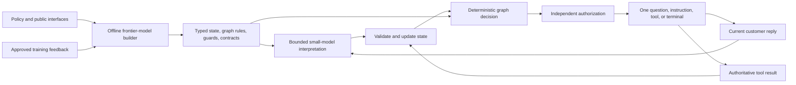

# Policy-State-Graph Harnesses

**Build the decision-making system once with a frontier model; use a smaller
model at runtime to interpret language inside that system.**

This repository documents two experiments in which a policy-derived knowledge
graph is the agent's controller, rather than advice supplied to an autonomous
LLM. It contains the construction methodology, a reusable builder prompt,
development histories, measured results, and curated aggregate evidence.

The experiments used a pinned Tau2 benchmark snapshot, not a current leaderboard
protocol. Telecom was developed first. Retail and airline were then developed
independently using the general method and their own permitted training evidence.

## The idea

A node represents **everything currently known that can affect the next
decision**: the customer's goal, target, authoritative records, observations,
unknowns, consent, pending work, and outstanding verification obligations.
An edge is a guarded question, diagnostic, customer instruction, backend
operation, internal state update, or terminal decision.

The runtime model does **not** choose tools, decide fixes, construct plans,
authorize writes, or declare success. These implementations use hierarchical
rules over typed state: an **implicit graph**, not an enumerated BFS search or
an automatic compiler for arbitrary policies. "Learning" means revising source
code and contracts; no model weights were trained.

## Baselines and final results

### Same-model graph-development baseline

These compare an **initial graph** with later graphs using `gpt-5.4-mini`.
They are not graph-versus-no-graph ablations.

| Project / cohort | Initial graph | Latest evaluated graph |
|---|---:|---:|
| Telecom, 74 training tasks | v1: 20/74 (27.03%) | v3: **73/74 (98.65%)** |
| Telecom, 40 test tasks x 3 | v2: 105/120 (87.50%) | v3: **119/120 (99.17%)** |
| Retail, 80 training tasks | Pass 1: 18/80 planned (22.50%) | Pass 7: **45/80 planned (56.25%)** |
| Airline, 35 training tasks | Pass 1: 23/35 planned (65.71%) | Pass 7: **25/35 planned (71.43%)** |

Telecom v3 also scored **115/120 (95.83%)** with
`Qwen/Qwen3-30B-A3B-Thinking-2507`, using the same frozen graph and prompts.
Its three trial scores were 36/40, 39/40, and 40/40, at concurrency **6**.
The mini trials were 40/40, 39/40, and 40/40, at concurrency **20**.

For retail/airline, the **best observed training snapshot was pass 6**, not
the latest pass 7: **76/115 planned (66.09%)** versus **70/115 (60.87%)**.
Pass 7 had 103 scored episodes and 12 unscored model-output errors.
Its 49 reserved test tasks have not been evaluated.

### Historical non-graph baselines using the same models

| Telecom runtime model | Historical non-graph base agent | Graph v3 |
|---|---:|---:|
| `gpt-5.4-mini` | 49/138 (35.51%) | 119/120 (99.17%) |
| `Qwen/Qwen3-30B-A3B-Thinking-2507` | 44/138 (31.88%) | 115/120 (95.83%) |

**These columns are context, not a controlled uplift comparison.** The
historical base agents used a 57/11/46 train/validation/test split and 46 test
tasks x 3; the graph project used the official 74/40 split and 40 test tasks
x 3. Serving conditions also differed. The historical agent was an
`LLMAgent`-based editable harness, not a claimed byte-identical stock-agent
control. **No matched no-graph baseline was measured for these graph cohorts.**

### Important interpretation

- Telecom v2's test evaluation was held out at that stage. Its failures were
  inspected before v3; v3 results are **known-test reruns**, not untouched
  generalization evidence.
- Qwen's final result includes one recovery of **44 unscored customer-model
  infrastructure errors**. All 76 originally scored records, including five
  failures, were preserved. No valid failure was retried.
- Official task success is not the same as reaching the graph's own `solved`
  state. No token/cost saving or rare-model-call claim is established.
- Training comparisons are descriptive: revisions were bundled, conversations
  were stochastic, and some concurrency/timeouts changed.

## Read the methodology

| Document | Purpose |
|---|---|
| [Construction and refinement playbook](docs/methodology.md) | End-to-end procedure, design principles, contracts, and failure-driven repairs |
| [Copyable frontier-builder prompt](prompts/frontier-builder.md) | Instructions for constructing a new policy-controlled harness |
| [Telecom case study](experiments/telecom.md) | v1 -> v2 -> v3, model swap, actual failures, and recovery |
| [Retail/airline case study](experiments/retail-airline.md) | Independent construction, all seven training passes, best versus latest |
| [Measurement and baseline rules](docs/measurement.md) | Denominators, comparability, model identity, and limits |
| [Reproduction and provenance](docs/reproduction.md) | Frozen source identities, evidence layout, and what is not shipped |
| [Machine-readable evidence](evidence/results.json) | Curated counts, trial consistency, and protocol metadata |

## Publication scope and attribution

This is a **methodology and results release**, not a runnable release of the
experimental harnesses. It does not redistribute benchmark tasks, databases,
customer personas, transcripts, provider logs, model weights, or the original
source repositories. Local source commits and evidence hashes identify the
retained originals; they are not promises of publicly downloadable archives.

Benchmark: [Sierra's Tau2](https://github.com/sierra-research/tau2-bench/tree/fc0055dc4e0a316c3f83133267fbd6faaa770992).
Open-weight model: [Qwen3-30B-A3B-Thinking-2507](https://huggingface.co/Qwen/Qwen3-30B-A3B-Thinking-2507/tree/144afc2f379b542fdd4e85a1fcd5e1f79112d95d).
Third-party sources retain their own licenses. Reported graph evaluations
were completed October 6-9, 2026; this publication does not add new evaluations.
